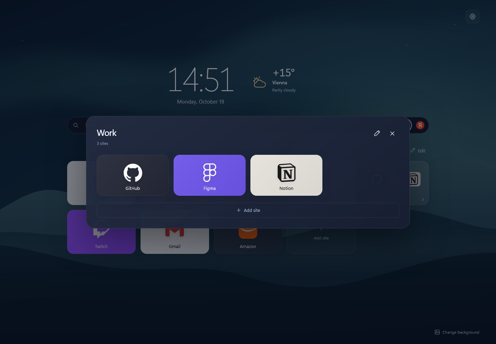
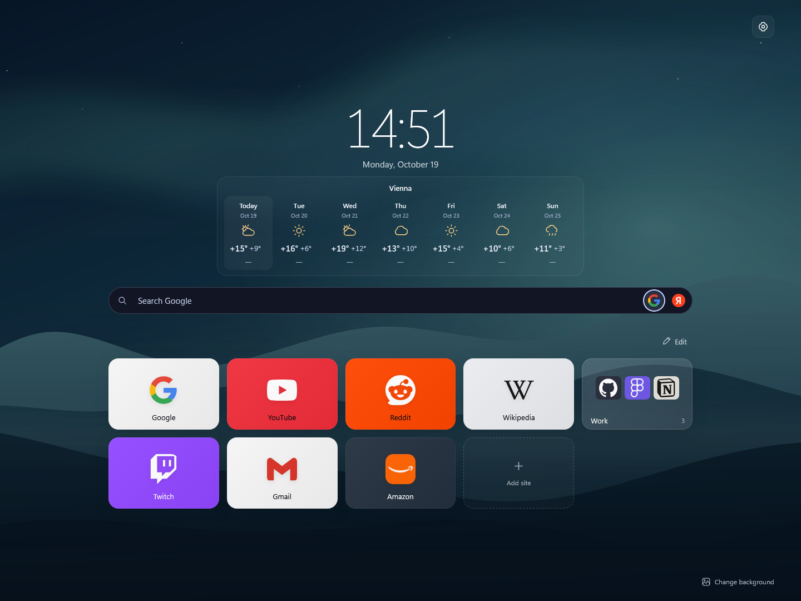

# Tablo for Firefox

[Русский](README.ru.md)

A new tab page for the sites you use every day. Keep them in folders, pick a background, and arrange the tiles your way.

## Features

- Site titles and icons are picked up automatically when you add a bookmark.
- Change tile colors and drag tiles into place.
- Group sites into folders and rearrange the contents.
- Search with Google, Yandex, Bing, DuckDuckGo, Brave, or Ecosia. Enable the engines you use in Settings and switch by clicking their icons in the search bar.
- Choose a built-in background or use your own image.
- Export your sites and settings to move them to another Firefox profile.

Tablo follows Firefox's language, with English and Russian available. You can override it in Settings → Language. A new English installation starts with Google, YouTube, Reddit, Wikipedia, Twitch, Gmail, Amazon, and a Work folder. Default icons are included, so they work offline. Changing the language keeps your existing bookmarks.

## Folders

Folder covers show icons for the first six sites. Click a folder to open it and arrange the sites inside.

## Weather

Choose a compact summary beside the clock or a separate seven-day forecast. The weekly widget shows the city above the forecast; click it for details. Set your city and choose Open-Meteo or MET Norway in settings. The external weather link opens Google in English and Yandex Weather in Russian.

## Try it

Firefox 140 or later is required. To run Tablo from source:

1. Download and unpack the project.
2. Open `about:debugging#/runtime/this-firefox` in Firefox.
3. Click **Load Temporary Add-on** and select `src/manifest.json`.

A temporary installation lasts until Firefox restarts. Use **Backup** in Tablo settings to save your sites and preferences.

Your sites and settings are stored in your Firefox profile. See the [privacy policy](PRIVACY.en.md) for details.

[Report an issue](https://github.com/jtedal/Tablo-Firefox/issues) · [Development guide, in Russian](docs/DEVELOPMENT.md) · [MIT license](LICENSE)
