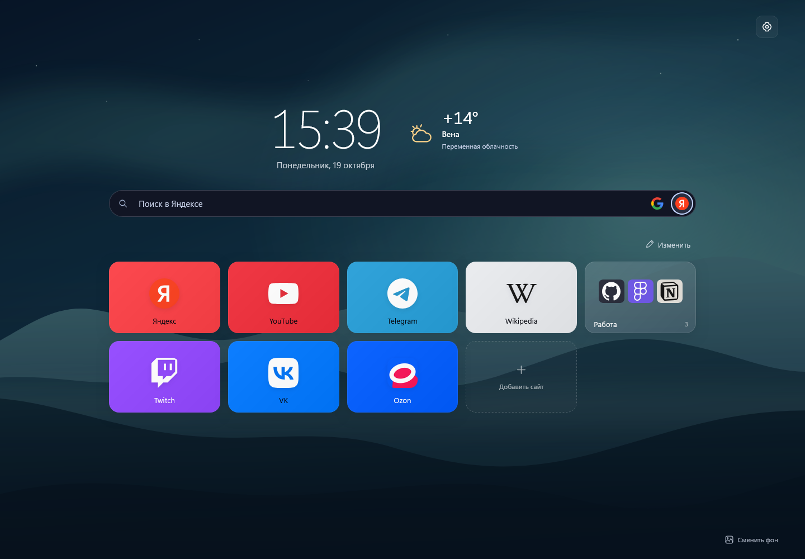
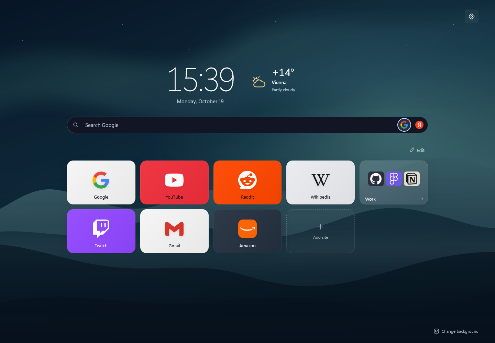
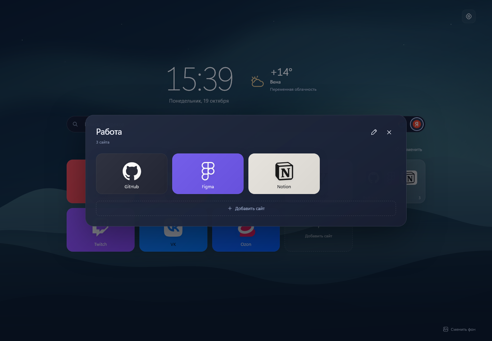
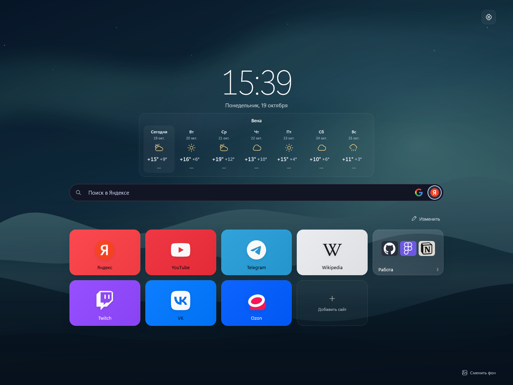

# Табло для Firefox

[English](README.md)

Стартовая страница с сайтами, которыми вы пользуетесь каждый день. Ссылки можно разложить по папкам, а фон и размер плиток — настроить под себя.

## Что можно делать

- Добавлять сайт по адресу — Табло само подберёт название и значок.
- Использовать русский или английский интерфейс: язык выбирается по Firefox, а в настройках его можно сменить вручную.
- Менять цвет плиток и расставлять их перетаскиванием.
- Собирать сайты в папки и менять порядок внутри них.
- Искать с новой вкладки через Google, Яндекс, Bing, DuckDuckGo, Brave или Ecosia. Включите нужные поисковики в настройках и переключайте их значками в строке поиска.
- Выбирать готовый фон или загружать свою картинку.
- Сохранять сайты и настройки в файл, чтобы перенести их в другой Firefox.

При первой установке набор сайтов зависит от языка: для русского — Яндекс, Telegram, VK и Ozon, для английского — Google, Reddit, Gmail и Amazon. Общие сайты и папка с рабочими сервисами есть в обоих вариантах. Значки стандартных плиток встроены и работают без сети. Смена языка не заменяет ваши сайты.

## Папки

На обложке видны значки первых шести сайтов. Нажмите на папку, чтобы открыть её содержимое.

## Погода

Можно выбрать сводку рядом с часами или отдельный виджет с прогнозом на неделю. Над недельным прогнозом видно название города. Нажмите на виджет, чтобы открыть подробности. Город и источник погоды — Open-Meteo или MET Norway — выбираются в настройках. Ссылка на внешний прогноз открывает Яндекс Погоду в русском интерфейсе и Google в английском.

## Установка

Нужен Firefox 140 или новее. Чтобы попробовать Табло из исходников:

1. Скачайте и распакуйте проект.
2. Откройте в Firefox `about:debugging#/runtime/this-firefox`.
3. Нажмите «Загрузить временное дополнение» и выберите `src/manifest.json`.

Это временная установка — до перезапуска Firefox. Сохранить сайты и настройки можно в разделе «Резервная копия» в настройках Табло.

Сайты и настройки хранятся в вашем профиле Firefox. Подробнее — в [политике конфиденциальности](PRIVACY.md).

[Что нового](CHANGELOG.md) · [Сообщить о проблеме](https://github.com/jtedal/Tablo-Firefox/issues) · [Для разработчиков](docs/DEVELOPMENT.md) · [Лицензия MIT](LICENSE)
